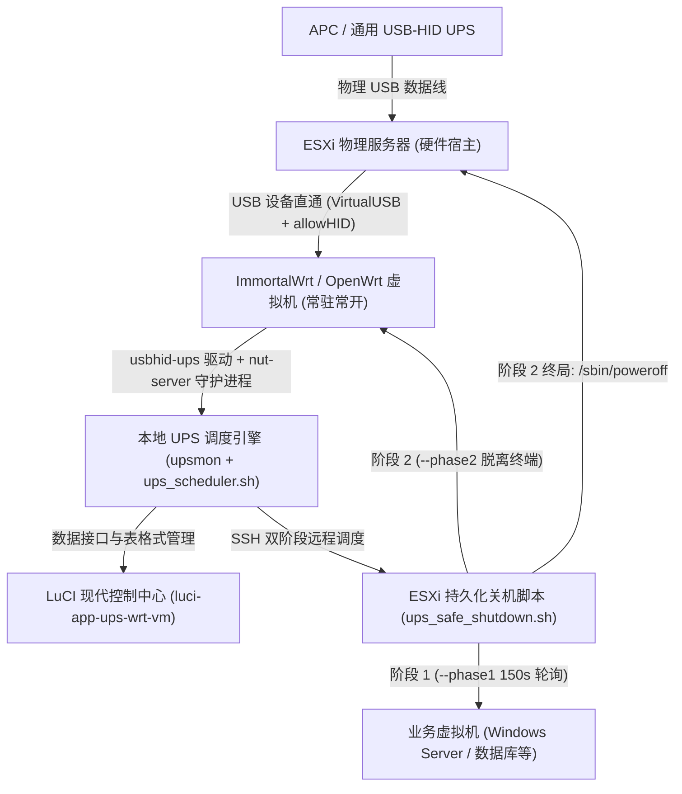
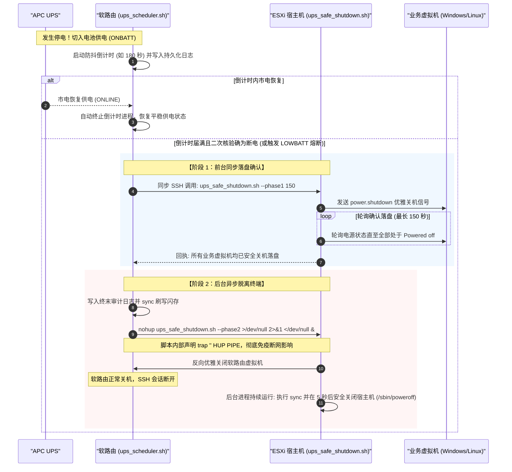

# UPS-WRT-VM

<div align="center">


**面向 VMware ESXi 宿主机与 OpenWrt / ImmortalWrt 软路由的现代智能 UPS 供电保护与双阶段防死锁安全关机体系**

[5分钟极速起步](docs/QUICK_START.md) • [系统使用说明书](docs/USER_MANUAL.md) • [硬件兼容与排错手册](docs/HARDWARE_AND_TROUBLESHOOTING.md) • [架构技术白皮书](docs/ARCHITECTURE.md)

</div>

---

## 一、 项目背景与核心痛点破局

在单台 x86 物理服务器（Dell / 联想 / 自组 NAS）部署 VMware ESXi 并常开软路由（OpenWrt/ImmortalWrt）的“All-in-One”家庭实验室中，外接 UPS 不间断电源的安全管理长期存在三大痛点：

1. **依赖过重**：传统方案通常在 ESXi 内部运行庞大的群晖（Synology）等系统接管 UPS，不仅额外侵占宝贵内存，群晖重启或升级时还会导致整网断电监控瘫痪；
2. **致命的“断网关机死锁”**：若软路由先关机，会导致 SSH 网络会话瞬间断开，ESXi 的 SSHD 会向后台关机脚本发送 `SIGHUP` 信号并抛出 `SIGPIPE`，**导致宿主机脚本中途被杀，根本走不到关机命令，最终耗尽电池直接断电摔坏硬盘**！
3. **部署繁琐门槛高**：传统 NUT 教程充斥着晦涩的底层配置文件、RSA 密钥手工拷贝以及 Linux 权限位报错，普通玩家极难一次跑通。

**UPS-WRT-VM 专为解决上述痛点而生**：由 24 小时常驻常开、超低开销的软路由接管 USB 设备直通，开创了**双阶段防死锁关机编排引擎**，并提供全中文 LuCI 控制中心与 Windows 一键傻瓜式部署器，让每个人都能轻松搭建企业级高可靠供电防线！

---

## 二、 核心架构与技术特性

### 1. 整体架构拓扑


### 2. 双阶段防死锁优雅关机时序（核心壁垒）


---

## 三、 LuCI 全中文现代化 Web 控制中心

登录软路由后台，在 **【服务】➔【UPS-WRT-VM 智能联动】** 中可体验一体化管理面板：

1. **纯 CSS/SVG 动态图形遥测仪表盘**：
   - 动态环形电量进度仪（绿 >50%、橙 20~50%、红 <20% 智能预警）；
   - 预计剩余放电续航时间动态换算（基于电池实时负载测算）；
   - 入户市电实时电压监控与脉冲供电状态呼吸指示灯；
   - 电池端电压遥测与 UPS 负载率动态柱状图。
2. **NUT 账户表格式管理与多设备共享**：
   - 类似云平台的交互式用户管理表格，支持动态添加从机只读账号（可供局域网内的群晖 NAS、PVE 节点、Windows 从机接入共享 UPS）；
   - 密码明文/密文一键切换，保存时自动同步写入 `/etc/config/nut_server` 与 `/etc/config/nut_monitor` 并平滑热重载。
3. **集成一键协议级握手测试**：
   - 在表格行内点击 **【⚡ 握手测试】**，一键完成真实 TCP 3493 协议认证与 ESXi SSH RSA 通路测试；
   - 看到绿灯即代表 100% 稳妥，**彻底告别冒着硬件损坏风险去拔物理插头的测试方式**！
4. **全链路持久化审计日志**：
   - 记录存放于 `/overlay` 物理闪存分区，断电关机后日志永不丢失，支持界面直接浏览与一键清空。

---

## 四、 极速安装与部署（3 种通道，任选其一）

### 通道 1（推荐）：Windows 桌面一键双击部署
适合使用 Windows 电脑管理局域网服务器的用户：
1. 下载本仓库，双击运行根目录下的 **`deploy.bat`**；
2. 在弹出的交互向导中输入软路由与 ESXi 的管理 IP 及 root 密码；
3. 向导自动调用随附的轻量绿色工具完成文件分发、免密密钥自动注入与自启固化，完成后**自动打开浏览器进入控制台**！

### 通道 2（小白级）：OpenWrt 网页直接上传安装包
1. 打开软路由后台：**【系统】➔【软件包】**；
2. 点击 **【上传软件包】**，选择本仓库 `packages/` 目录下的 **`luci-app-ups-wrt-vm_1.0.0_all.ipk`**；
3. 安装完成后刷新页面，在【服务】菜单下进入并填入 ESXi IP 即可。

### 通道 3（终端级）：命令行脚本一键直装
- **ESXi 宿主机**：上传 `esxi/` 目录到 `/vmfs/volumes/datastore1/scripts/`，执行 `sh quick_install.sh`；
- **软路由端**：上传 `openwrt/` 目录到 `/tmp/`，执行 `sh openwrt/quick_install.sh`。

详细步骤请参阅：👉 **[《5分钟极速起步指南》](docs/QUICK_START.md)**

---

## 五、 硬件兼容与测试清单

| 品牌系列 | 代表机型 | 驱动协议 | 兼容表现 |
| :--- | :--- | :---: | :--- |
| **APC (施耐德)** | **Back-UPS XS 650CI / BK650 / BR1000** | `usbhid-ups` | 🟢 完美支持：电量、端电压、市电输入、负载率、放电续航全部精准遥测 |
| **山特 (SANTAK)** | **TG-BOX 850 / 600** | `usbhid-ups` | 🟢 完美支持：USB 接口版本开箱即用 |
| **雷迪司 (LADIS)** | **H1000 / H2000** | `usbhid-ups` | 🟢 完美支持：标准 USB HID 协议兼容 |
| **硕天 (CyberPower)** | **CP1000 / CP1500** | `usbhid-ups` | 🟢 完美支持：纯正弦波系列兼容 |

详细硬件列表与避坑指引请参阅：👉 **[《硬件兼容清单与排错手册》](docs/HARDWARE_AND_TROUBLESHOOTING.md)**

---

## 六、 仓库目录架构

```text
UPS-WRT-VM/
├── deploy.bat                                 # Windows 专属 4 行极简启动器 (双击即用)
├── deploy.ps1                                 # Windows 自动化部署向导 (显式输IP、自动推送/打通免密/弹网页)
├── tools/                                     # 绿色便携工具箱 (跨 Windows 环境 100% 成功)
│   ├── plink.exe                              # 轻量 SSH 通信工具
│   └── pscp.exe                               # 轻量 SCP 文件传输工具
├── packages/                                  # 预编译通用安装包目录
│   └── luci-app-ups-wrt-vm_1.0.0_all.ipk      # 通用免编译安装包 (OpenWrt Web后台直接上传安装)
├── .github/
│   └── workflows/
│       └── ci.yml                             # GitHub CI 自动化静态语法校验 (Lua / ShellCheck)
├── openwrt/
│   ├── quick_install.sh                       # 软路由一键傻瓜式极速安装脚本
│   └── luci-app-ups-wrt-vm/                   # 标准 OpenWrt Feed / SDK 插件源码目录
│       ├── Makefile                           # 标准 OpenWrt 包描述与依赖定义
│       ├── luasrc/
│       │   ├── controller/
│       │   │   └── ups_wrt_vm.lua             # 路由控制器、遥测 API、诊断接口
│       │   └── model/
│       │       └── cbi/
│       │           └── ups_wrt_vm.lua         # 现代化 SVG 动态仪表盘、用户管理表格
│       └── root/
│           ├── etc/
│           │   ├── config/
│           │   │   ├── ups_manager            # 规范默认 UCI 配置文件 (出厂标准值)
│           │   │   └── ups_manager.example    # 完整字段中文注释参考文件
│           │   └── nut/
│           │       └── ups_scheduler.sh       # 断电防抖守护、二次状态复核与双阶段关机调度
├── esxi/
│   ├── quick_install.sh                       # ESXi 宿主机一键傻瓜式极速安装向导
│   └── ups_safe_shutdown.sh                   # 双阶段防死锁关机编排脚本 (--phase1/--phase2)
├── docs/
│   ├── QUICK_START.md                         # 5分钟快速部署教程 (Windows双击 / 网页上传 / 终端一键)
│   ├── USER_MANUAL.md                         # 详尽系统使用说明书与配置指南 (仪表盘/群晖从机/参数调优)
│   ├── HARDWARE_AND_TROUBLESHOOTING.md         # 硬件兼容清单、ESXi allowHID 避坑指南与常见 FAQ
│   └── ARCHITECTURE.md                        # 架构设计与双阶段防死锁原理解析
├── .gitignore                                 # 严格排除日志、临时文件、用户私钥与本地缓存
├── LICENSE                                    # MIT 开源许可证
├── README.md                                  # 工业级开源项目中文主文档 (架构图、使用教程、特性徽章)
└── CHANGELOG.md                               # 版本发布与演进记录
```

---

## 七、 许可证 (License)

本项目采用 [MIT 许可证](LICENSE) 开源发布，欢迎自由衍生、修改与社区共享！

