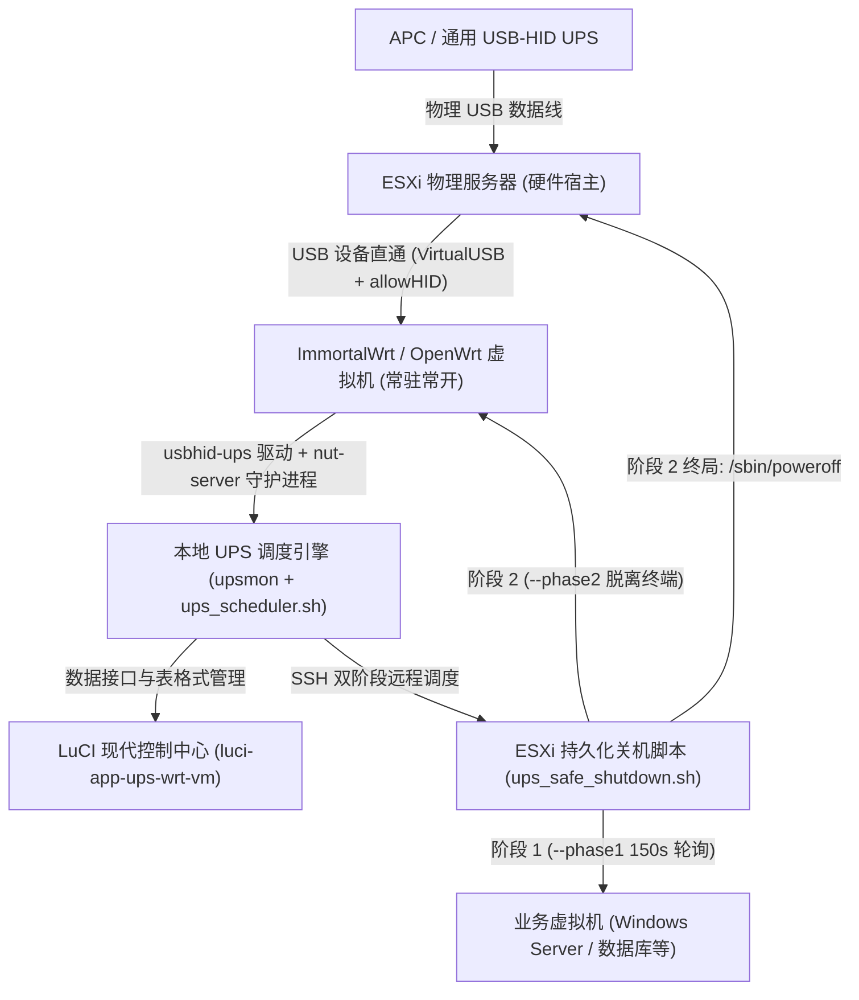
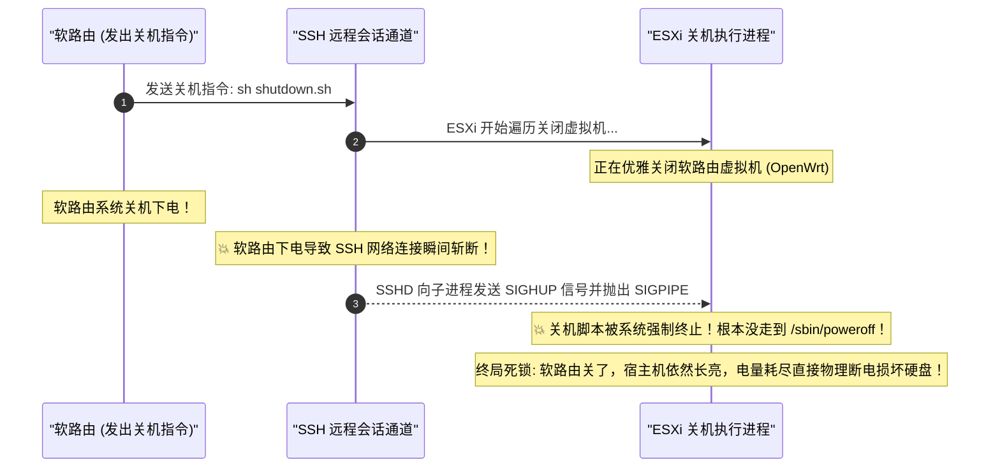
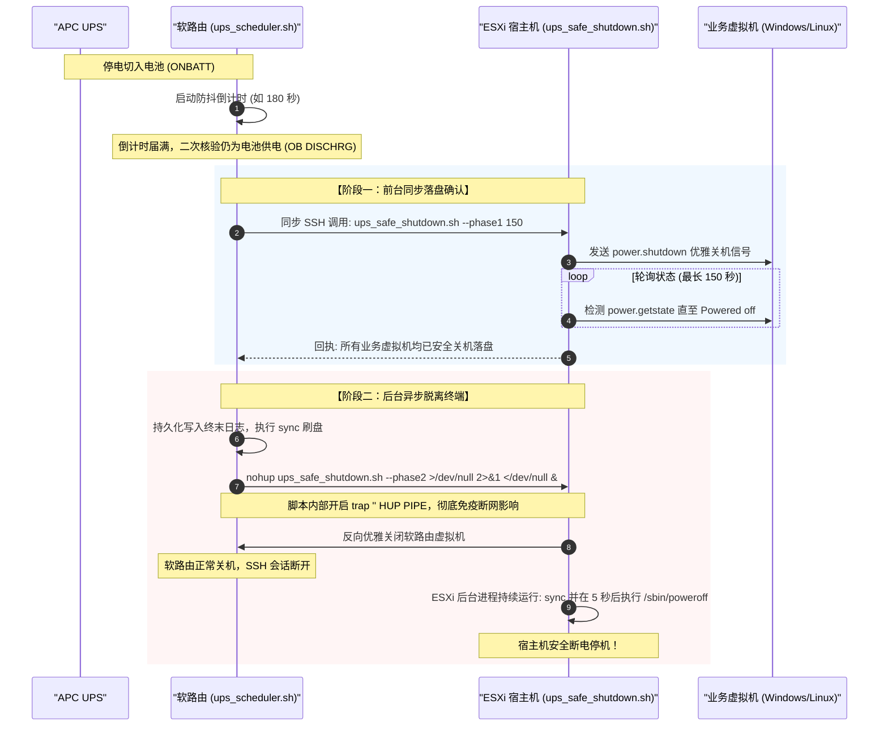

# UPS-WRT-VM 核心架构设计与双阶段防死锁技术白皮书

---

## 一、 系统架构总览

在单台 x86 物理服务器（如 Dell Precision / 联想工作站 / 自组 NAS）部署虚拟化环境（VMware ESXi）并运行软路由（OpenWrt/ImmortalWrt）的“All-in-One”场景下，外接 UPS 电源的断电保护向来是业界的经典架构难题。

本项目摒弃了传统方案在 ESXi 内部运行笨重群晖虚拟机接管 UPS 的弊端，构建了一套轻量化、高可用、全链路防死锁的现代供电保护架构：

---

## 二、 传统方案的致命缺陷：为什么会导致“宿主机悬死死锁”？

在常规的双机网络关机方案中，软路由往往在检测到断电超时后，先向宿主机发送关机指令，或者软路由与宿主机同时关机。这会引发一个灾难性的 **SIGHUP 断连自杀死锁**：

---

## 三、 本项目破局方案：双阶段防死锁关机编排引擎

为了从根本上彻底杜绝此死锁，本项目将安全关机严格解耦为**两个确定性阶段**：

### 核心防死锁设计要素
1. **信号双重免疫 (`trap '' HUP PIPE`)**：
   在 ESXi 端脚本的头部显式声明忽略挂起信号 `SIGHUP` 与管道破裂信号 `SIGPIPE`，无论前台 SSH 如何断开，后台进程受内核绝对保护；
2. **脱离终端守护 (`nohup ... </dev/null &`)**：
   阶段二以完全脱离标准输入输出的文件描述符后台启动，由 ESXi 本地调度系统托管运行；
3. **反向优雅关闭软路由**：
   业务机完全停稳前，软路由作为监控哨兵绝对不关；业务机全部落盘后，才由 ESXi 宿主机从虚拟化层下发关闭软路由，时序井然有序。

---

## 四、 来电开机自愈防冲击机制 (AutoStart Order)

市电恢复供电时，电网往往伴随短时间的电压波动或多次反复通断电。若所有虚拟机与大容量机械硬盘阵列并发开机，会产生巨大的浪涌电流，甚至因电网再次闪断对磁头造成二次致命敲击。

本项目实施了精密的**单兵自愈机制**：
- **仅拉起软路由**：
  在 ESXi AutoStart 序列中，**唯独将软路由虚拟机标记为 `powerOn`**，其余所有虚拟机默认全部配置为 `none`；
- **自愈收益**：
  1. 物理机来电后，快速且唯一启动低功耗的软路由，率先恢复全屋/全实验室网络与 DNS 解析；
  2. 机械硬盘与业务大负载在电网未完全平稳前保持休眠，避开电网闪断风险；
  3. 用户确认市电彻底稳定后，可通过软路由后台或 ESXi 控制台手动或按需唤醒核心业务机。

