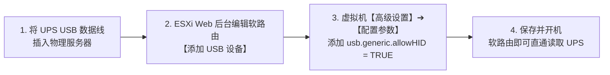

# UPS-WRT-VM 5分钟极速起步指南

欢迎使用 **UPS-WRT-VM**！本指南专为家庭 NAS、All-in-One 玩家打造，提供 **Windows 一键部署向导**、**Web 后台上传 IPK** 与 **终端命令行脚本** 3 种极简安装通道，无论您的技术基础如何，均可在 5 分钟内完成全套部署。

---

## 一、 部署前准备：ESXi 宿主机硬件直通（只需 1 分钟）

在开始部署前，请先确保外接 USB UPS 设备已成功直通给软路由虚拟机：



> [!IMPORTANT]
> **关键防坑提示**：
> VMware ESXi 7.0/8.0 默认会隐藏并独占标准人机接口（HID）类 USB 设备，导致直通选项变灰或软路由识别不到。
> **务必在虚拟机【配置参数】中新增一项**：
> - 名称：`usb.generic.allowHID`
> - 值：`TRUE`

---

## 二、 三大部署通道（任选一种即可）

### 通道 A（推荐）：Windows 桌面一键自动化部署向导

如果您正在使用 Windows 10 / 11 电脑管理您的局域网服务器，这是最省心、最快捷的方式：

1. **下载项目**：
   下载本仓库或解压 `UPS-WRT-VM` 文件夹到您的 Windows 电脑；
2. **双击启动器**：
   双击运行根目录下的 **`deploy.bat`**；
3. **根据提示输入 IP 与密码**：
   - 输入软路由的管理 IP（如 `192.168.1.1`）与 root 密码；
   - 输入 ESXi 宿主机的管理 IP（如 `192.168.1.100`）与 root 密码；
4. **全自动完成**：
   向导将通过内置的便携工具自动完成文件推送、底层依赖检查、跨节点 SSH RSA 免密绑定与开机自启固化，并在完成后**自动为您打开浏览器进入控制台**！

---

### 通道 B（小白级）：OpenWrt 网页后台直接上传 .ipk

如果您更习惯在网页上操作：

1. 打开软路由 Web 管理界面（LuCI），进入：**【系统】➔【软件包】**；
2. 点击 **【上传软件包】** 按钮；
3. 选择本仓库 `packages/` 目录下的 **`luci-app-ups-wrt-vm_1.0.0_all.ipk`** 并点击上传安装；
4. 安装完成后，刷新浏览器页面，在顶部【服务】菜单下即可看到 **【UPS-WRT-VM 智能联动】**；
5. 进入页面后输入 ESXi 宿主机的 IP 地址，点击行内的 **【⚡ 握手测试】** 按钮，验证通过后点击底部【保存并应用】即可！

---

### 通道 C（极客级）：终端命令行脚本一键直装

如果您习惯直接在 SSH 终端敲命令：

#### 1. ESXi 宿主机部署
通过 SSH 连入 ESXi 宿主机，将本仓库 `esxi/` 目录上传后执行：
```sh
cd /vmfs/volumes/datastore1/
mkdir -p scripts && cd scripts
# 将 esxi/ 下的脚本上传至此后执行：
sh quick_install.sh
```

#### 2. 软路由端部署
通过 SSH 连入 OpenWrt / ImmortalWrt 软路由，将 `openwrt/` 目录上传后执行：
```sh
cd /tmp
# 将 openwrt/ 下的目录上传至此后执行：
sh openwrt/quick_install.sh
```
脚本执行完毕后会高亮打印出一条 ESXi 配对命令，将其粘贴到 ESXi 执行即可一键打通免密！

---

## 三、 Web 界面一键验证（告别危险的“拔插头测试”）

部署完成后，打开浏览器进入软路由后台：**`http://<软路由IP>/cgi-bin/luci/admin/services/ups_wrt_vm`**：

1. **查看仪表盘**：确认电池电量、剩余续航时间、市电输入电压正常波动呈现；
2. **凭据与链路自检**：在下方的用户表格行内点击 **【⚡ 握手测试】**；
3. **绿灯确认**：
   - 若回显包含 `[LOGIN OK]` 且 `ESXi 宿主机 SSH RSA 免密通路正常`，说明整套供电保护链路已经 100% 严密闭环，无需承担任何破坏性物理拔电风险！

